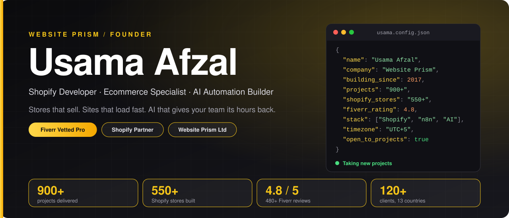
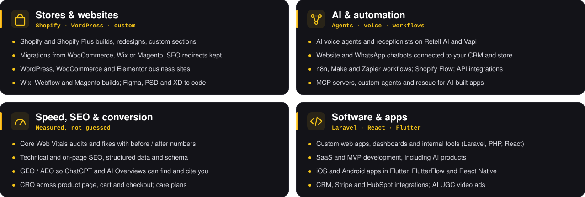
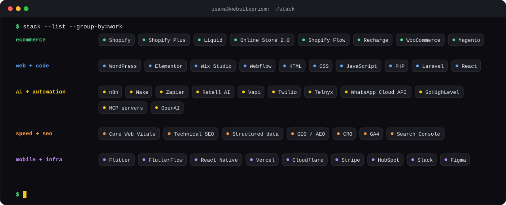
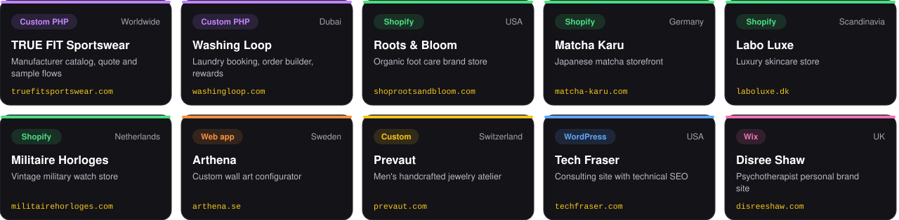
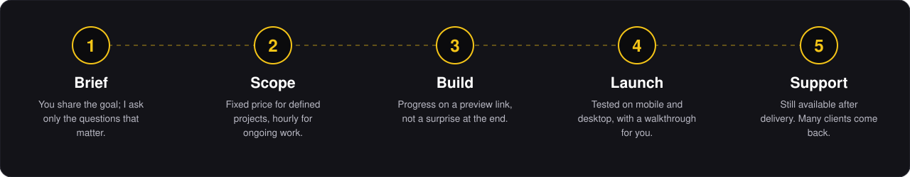
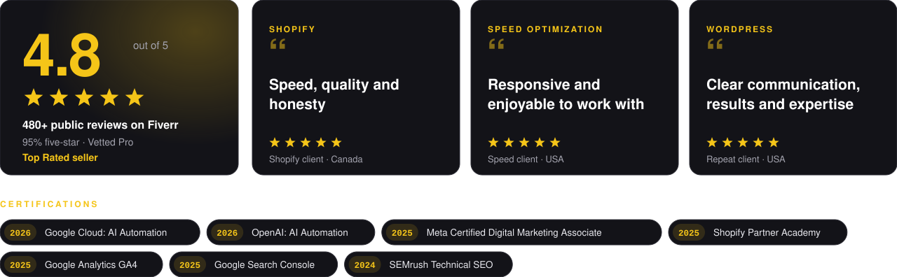

  
  
  
  
  

I build online stores, business websites and AI automation for companies in the USA, UK, Canada, Europe, the Middle East and New Zealand. I started on WordPress in 2017 and Shopify in 2018, founded [Website Prism](https://websiteprism.com) in 2020, and have delivered **900+ projects, 550+ of them Shopify stores**. I lead every project myself, with the Website Prism team behind me on larger builds.

I also run businesses of my own (co-founder of [TRUE FIT Sportswear](https://truefitsportswear.com), a custom sportswear manufacturer), so I build for what the store has to do for the company behind it, not only for how it looks.

---

## What I build

<b>See the full list of services</b>

 

| Area | Services |
|---|---|
| **Shopify** | New stores, redesigns, custom sections and features, Shopify Plus, B2B and wholesale setups, subscriptions, bundles and upsell systems, one-product stores, migrations from WooCommerce, Wix or Magento with redirects |
| **WordPress and other platforms** | Business sites, WooCommerce stores, Elementor builds, Wix and Wix Studio, Webflow, Magento, Figma / PSD / XD to responsive code |
| **AI and automation** | Voice agents and AI receptionists (Retell AI, Vapi), website and WhatsApp chatbots, customer service and lead research agents, document processing agents, ecommerce operations agents, MCP servers, n8n / Make / Zapier workflows, Shopify Flow, GoHighLevel, rescue and production audits for apps built with Lovable, Bolt, Cursor or Replit |
| **Speed, SEO and conversion** | Core Web Vitals (LCP, CLS, INP) audits and fixes with before / after measurements, technical and on-page SEO, product and collection SEO, structured data, GEO and AEO for AI search, conversion rate optimization, maintenance and support plans |
| **Software and apps** | Custom web applications and internal tools in Laravel, PHP and React, SaaS and AI SaaS, MVPs for startups, Flutter / FlutterFlow / React Native apps for iOS and Android, CRM, Stripe, HubSpot and Slack integrations |
| **Marketing** | Social media management, AI UGC video ads for TikTok, Reels and YouTube |

---

## My stack

---

## Selected work

  <a href="https://truefitsportswear.com">TRUE FIT</a> ·
  <a href="https://washingloop.com">Washing Loop</a> ·
  <a href="https://shoprootsandbloom.com">Roots &amp; Bloom</a> ·
  <a href="https://matcha-karu.com">Matcha Karu</a> ·
  <a href="https://laboluxe.dk">Labo Luxe</a> ·
  <a href="https://militairehorloges.com">Militaire Horloges</a> ·
  <a href="https://arthena.se">Arthena</a> ·
  <a href="https://prevaut.com">Prevaut</a> ·
  <a href="https://techfraser.com">Tech Fraser</a> ·
  <a href="https://disreeshaw.com">Disree Shaw</a>

<b><a href="https://usama.websiteprism.com">All 24 live sites and client reviews on my portfolio →</a></b>

---

## Open-source tools

Small, working pieces of the kind of code I ship for clients. Free to use under the MIT license.

| Repository | What it does | Built with |
|---|---|---|
| [**shopify-sections**](https://github.com/Usama-Afzall/shopify-sections) | Three drop-in Online Store 2.0 sections: trust badges bar, FAQ accordion that outputs valid FAQPage schema, and a sticky add-to-cart bar |   |
| [**n8n-workflows**](https://github.com/Usama-Afzall/n8n-workflows) | Importable workflows: Shopify orders to Slack and Google Sheets, and AI lead qualification into HubSpot |   |
| [**ai-voice-agent-starter**](https://github.com/Usama-Afzall/ai-voice-agent-starter) | Starter kit for an AI voice receptionist: Vapi assistant config, secured webhook server for booking tools, and a tested prompt |   |
| [**mcp-server-starter**](https://github.com/Usama-Afzall/mcp-server-starter) | Minimal Python MCP server that lets Claude and other AI clients query store orders and products, with an automated test suite |   |
| [**geo-aeo-toolkit**](https://github.com/Usama-Afzall/geo-aeo-toolkit) | llms.txt generator, JSON-LD schema templates and an AI-visibility checklist for answer-engine optimization |   |
| [**wordpress-speed-toolkit**](https://github.com/Usama-Afzall/wordpress-speed-toolkit) | Lightweight WordPress plugin with safe front-end speed tweaks and a clean Settings API page |   |
| [**laravel-lead-api**](https://github.com/Usama-Afzall/laravel-lead-api) | Laravel 11 lead-capture API with FormRequest validation, rate limiting, honeypot, events and PHPUnit tests (tests not yet run in a live app) |   |

---

## How I work

---

## Trusted by clients, backed by certifications

Ratings and review count are from my public Fiverr profile at [fiverr.com/shopify_xpert01](https://www.fiverr.com/shopify_xpert01).

---

  <a href="https://usama.websiteprism.com/contact"><b>Contact form</b></a> &nbsp;·&nbsp;
  <a href="mailto:usama@websiteprism.com"><b>usama@websiteprism.com</b></a> &nbsp;·&nbsp;
  <a href="https://websiteprism.com"><b>websiteprism.com</b></a> &nbsp;·&nbsp;
  <a href="https://www.fiverr.com/shopify_xpert01"><b>Fiverr</b></a> &nbsp;·&nbsp;
  <a href="https://www.linkedin.com/in/usama-afzal"><b>LinkedIn</b></a> &nbsp;·&nbsp;
  <a href="https://www.shopify.com/partners/directory/partner/usama-afzal-enterprises"><b>Shopify Partner Directory</b></a>

