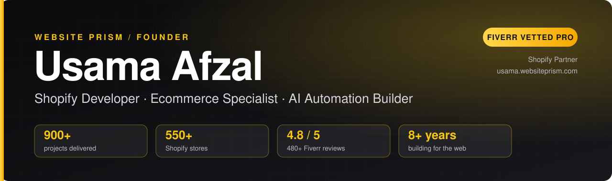

  

  
  
  
  
  

<h3 align="center">Online stores that sell, websites that load fast, and AI automation that saves your team hours.</h3>

  <a href="https://usama.websiteprism.com/contact"><b>Start a project</b></a> &nbsp;·&nbsp;
  <a href="https://usama.websiteprism.com"><b>See my work</b></a> &nbsp;·&nbsp;
  <a href="https://www.fiverr.com/shopify_xpert01"><b>Read client reviews</b></a>

---

## 👋 About me

I'm Usama, founder of [Website Prism](https://websiteprism.com). I build and optimize Shopify stores, business websites and AI automation for companies in the USA, UK, Canada, Europe, the Middle East and New Zealand.

| | |
|---|---|
| 🛒 **550+ Shopify stores** | Part of 900+ projects delivered since 2017 |
| ⭐ **4.8 / 5 on Fiverr** | 480+ public reviews, Fiverr Vetted Pro |
| 🏢 **Website Prism Ltd** | Founded 2020, registered in England & Wales |
| 🤝 **Shopify Partner** | Listed in the Shopify Partner Directory |
| 🏭 **Business owner too** | Co-founder of [TRUE FIT Sportswear](https://truefitsportswear.com), so I know what a store has to do for the business behind it |
| 🌍 **UTC+5** | My working day overlaps UK/EU business hours and US mornings |

I lead every project personally, with the Website Prism team behind me on larger builds.

---

## 🚀 What I can do for you

<table>
<tr>
<td width="50%" valign="top">

### 🛍️ Stores and websites
- **Shopify development**: new stores, redesigns, custom sections and features
- **Shopify Plus and B2B**: wholesale setups, subscriptions, bundles, upsells
- **Migrations**: WooCommerce, Wix or Magento to Shopify with redirects, so SEO is preserved
- **WordPress and WooCommerce**: business sites, Elementor builds, redesigns
- **Wix, Webflow and Magento** builds and redesigns
- **Design to code**: Figma, PSD or XD to responsive Shopify or WordPress
- **One-product stores** for focused product launches

</td>
<td width="50%" valign="top">

### 🤖 AI and automation
- **AI voice agents**: inbound and outbound calling agents and AI receptionists (Retell AI, Vapi)
- **AI chatbots**: website and WhatsApp agents connected to your store, content and CRM
- **AI agents**: customer service, lead research, document processing, ecommerce operations
- **Workflow automation**: n8n, Make, Zapier, Shopify Flow
- **MCP servers**: connect AI assistants to your business systems
- **AI app rescue**: production audits and fixes for apps built with Lovable, Bolt, Cursor or Replit

</td>
</tr>
<tr>
<td width="50%" valign="top">

### ⚡ Speed, SEO and conversion
- **Speed and Core Web Vitals**: audits and fixes for Shopify and WordPress, with before/after measurements
- **Technical and on-page SEO**: audits, product and collection SEO, schema markup
- **AI SEO (GEO and AEO)**: content and structure prepared for ChatGPT, Perplexity and Google AI Overviews
- **Conversion rate optimization**: product page, navigation, cart and checkout
- **Maintenance and support plans** for live sites

</td>
<td width="50%" valign="top">

### 💻 Software, apps and marketing
- **Custom web applications**: Laravel, PHP and React, dashboards and internal tools
- **SaaS and MVP development**, including AI SaaS products
- **Mobile apps**: Flutter, FlutterFlow and React Native for iOS and Android
- **API integrations**: CRMs, Stripe, HubSpot, Slack, webhooks
- **Social media management**
- **AI UGC video ads** for TikTok, Reels and YouTube

</td>
</tr>
</table>

---

## 🧰 Tech stack

**Ecommerce**

**Websites and code**

**AI and automation**

**Performance, SEO and analytics**

**Mobile and infrastructure**

---

## 🌐 Selected work

| Project | What it is | Platform | Market |
|---|---|---|---|
| [**TRUE FIT Sportswear**](https://truefitsportswear.com) | 24-category manufacturer catalog with quote and sample flows | Custom PHP | Worldwide |
| [**Washing Loop**](https://washingloop.com) | Laundry booking with per-item order builder and rewards | Custom PHP | Dubai |
| [**Roots and Bloom**](https://shoprootsandbloom.com) | Organic foot care brand store | Shopify | USA |
| [**Matcha Karu**](https://matcha-karu.com) | Japanese matcha storefront | Shopify | Germany |
| [**Labo Luxe**](https://laboluxe.dk) | Luxury skincare store | Shopify | Scandinavia |
| [**Militaire Horloges**](https://militairehorloges.com) | Vintage military watch store | Shopify | Netherlands |
| [**Arthena**](https://arthena.se) | Custom wall art configurator | Web app | Sweden |
| [**Prevaut**](https://prevaut.com) | Men's handcrafted jewelry atelier | Custom | Switzerland |
| [**Tech Fraser**](https://techfraser.com) | Business consulting site with SEO | WordPress | USA |
| [**Disree Shaw**](https://disreeshaw.com) | Psychotherapist personal brand site | Wix | UK |

➡️ More live sites and client reviews at [usama.websiteprism.com](https://usama.websiteprism.com)

---

## 🎓 Certifications

| Year | Certification |
|---|---|
| 2026 | Google Cloud: AI Automation |
| 2026 | OpenAI: AI Automation |
| 2025 | Meta Certified Digital Marketing Associate |
| 2025 | Shopify Partner Academy |
| 2025 | Google Analytics GA4 |
| 2025 | Google Search Console |
| 2024 | SEMrush Technical SEO |

---

## 🧭 How I work

1. **Brief**: you tell me the goal, I ask the few questions that matter.
2. **Scope and price**: fixed price for defined projects, hourly for ongoing work.
3. **Build**: you see progress on a preview link, not just at the end.
4. **Launch and handover**: tested on mobile and desktop, with a walkthrough so you can run it yourself.
5. **Support**: I stay available after delivery, and many clients come back for the next project.

---

## 📫 Let's talk

  

  <a href="https://websiteprism.com">websiteprism.com</a> &nbsp;·&nbsp;
  <a href="mailto:usama@websiteprism.com">usama@websiteprism.com</a> &nbsp;·&nbsp;
  <a href="https://www.fiverr.com/shopify_xpert01">Fiverr</a> &nbsp;·&nbsp;
  <a href="https://www.linkedin.com/in/usama-afzal">LinkedIn</a> &nbsp;·&nbsp;
  <a href="https://www.shopify.com/partners/directory/partner/usama-afzal-enterprises">Shopify Partner Directory</a>

